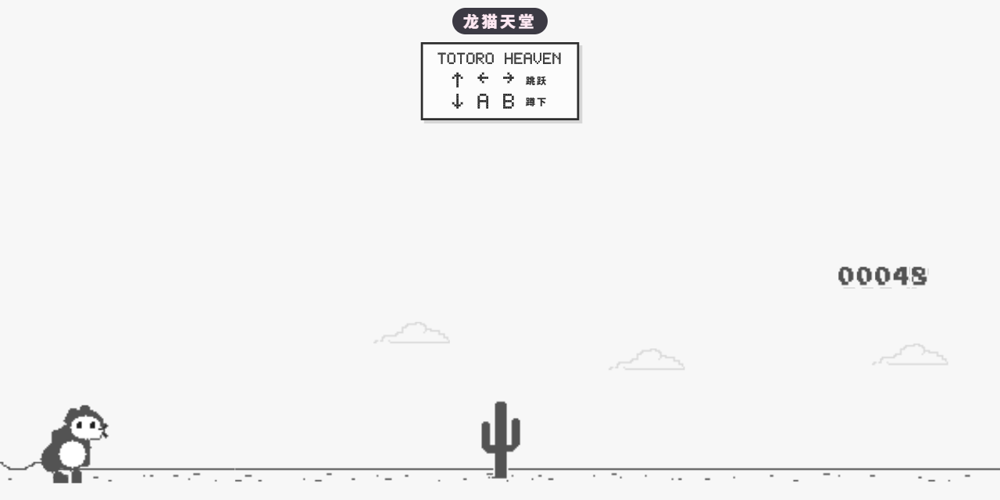

# 龙猫天堂

一款以「龙猫天堂」为主题的像素跑酷小游戏：像素龙猫一直向前跑，越过路上的仙人掌。

---

## 玩法

龙猫会一直向右跑（越跑越快），你要帮它跳过路上的仙人掌 —— 分数更高时还会有低空飞过的家伙，蹲下就能躲过。

| 按键 | 作用 |
| --- | --- |
| `↑` / `←` / `→` / `空格` | 跳（轻点小跳、按住大跳） |
| `↓` / `A` / `B` | 蹲下 |
| `Enter` | 撞到后重来 |

- 打开后先是**待机画面**（龙猫原地眨眼），按跳跃键开始跑；
- 撞上仙人掌就结束，画面显示本次里程与最高分（HI）；
- 最高分只记在本次游玩期间，重开软件就归零；
- 跑到一定分数天会入夜（画面反色），再跑一段又回到白天。

## 关于这个仓库

游戏画面用 Canvas 按帧现画（精灵图内嵌、无外部资源请求），不依赖任何游戏引擎 —— 完全离线可玩。

- 技术栈：Nuxt 3 + Vue 3（游戏本身无账号、不联网）
- 运行方式：打开即玩，不需要注册或登录

## 许可

MIT License，详见 [LICENSE](LICENSE)。
游戏部分基于 Chromium 的离线小恐龙跑酷（BSD 风格许可，版权归 The Chromium Authors；出处与改动说明见 `public/trex/runner.js` 文件头）。

## 更新日志

见 [CHANGELOG.md](CHANGELOG.md)。
